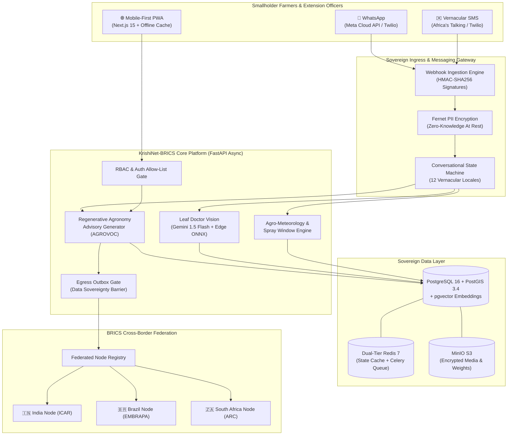

# 🌾 KrishiNet-BRICS (AgriN Commons)
### Sovereign Regenerative Agricultural Intelligence & Cross-Border BRICS Federation

[](https://opensource.org/licenses/Apache-2.0)
[](https://digitalpublicgoods.net/)
[](https://www.python.org/)
[-black)](https://nextjs.org/)
[](https://github.com/)
[](scripts/preflight.py)
[](infra/helm/)

> **"One field. Many nations. Shared intelligence."**  
> KrishiNet-BRICS is an offline-first, edge-native, multi-channel Digital Public Good delivering precision regenerative agronomy, biological IPM, AI disease diagnosis, agro-meteorological spray windows, and sovereign cross-border federation for smallholder farming communities across India, Brazil, South Africa, and BRICS+ partner nations.

---

## 📑 Table of Contents
1. [Core Capabilities & Architectural Pillars](#-core-capabilities--architectural-pillars)
2. [End-to-End Implementation Across All 8 Phases](#-end-to-end-implementation-across-all-8-phases)
3. [System Architecture Diagram](#-system-architecture-diagram)
4. [Technology Stack](#-technology-stack)
5. [Quick Start & Local Execution](#-quick-start--local-execution)
6. [Interactive WhatsApp & SMS Bot Simulator](#-interactive-whatsapp--sms-bot-simulator)
7. [Testing, Quality Gates & Preflight Verification](#-testing-quality-gates--preflight-verification)
8. [Deployment Tracks & Economic Cost Model](#-deployment-tracks--economic-cost-model)
9. [Git Setup & GitHub Push Guide](#-git-setup--github-push-guide)
10. [Digital Public Good Compliance & License](#-digital-public-good-compliance--license)

---

## 🌟 Core Capabilities & Architectural Pillars

- **🛡️ Radical Data Sovereignty**: Local-soil data storage adhering to India's DPDP Act 2023, Brazil's LGPD, and South Africa's POPIA. Cryptographic receipts for every consent, with instant "Delete My Data" right-to-be-forgotten cryptographic shredding.
- **📱 Zero-Barrier Vernacular Outreach**: Two-way interactive messaging bot operating across **WhatsApp** (Meta Cloud API & Twilio) and low-bandwidth **vernacular SMS** (Africa's Talking) in 12 languages.
- **🌿 Regenerative Agriculture First**: Strict prioritization of biological IPM (Trichoderma, Neem oil, Beauveria bassiana), cover cropping, bio-fertilizers, and soil carbon regeneration over synthetic agrochemicals.
- **👁️ Dual-Tier Edge AI Diagnostics**: Hybrid leaf doctor vision pipeline combining **Gemini 1.5 Flash Vision** with zero-network **Edge ONNX** local neural network fallbacks.
- **🌐 Privacy-Preserving BRICS Federation**: Federated knowledge sharing without exporting raw farmer PII. Secure cross-border queries between national research nodes (ICAR India, EMBRAPA Brazil, ARC South Africa).

---

## 🚀 End-to-End Implementation Across All 8 Phases

```
┌───────────────────────────────────────────────────────────────────────────────────────────┐
│                               KRISHINET-BRICS PLATFORM PHASES                             │
├─────────────┬─────────────────────────────────────────────────────────────────────────────┤
│ Phase 1     │ Sovereign Data Schema, PostGIS Polygons, Consent Receipts, Audit Vault      │
│ Phase 2     │ FastAPI Async Backend, RBAC Security, Token Auth, Outbox Egress Gate        │
│ Phase 3     │ Sentinel-2 STAC NDVI, SoilGrids 2.0, Open-Meteo Microclimate Spray Windows  │
│ Phase 4     │ Regenerative Agronomy RAG, AGROVOC Ontology, Multi-Layer Safety Guardrails  │
│ Phase 5     │ Leaf Doctor Vision (Gemini + ONNX), IPM Protocols, Outbreak Intelligence    │
│ Phase 6     │ Mobile-First PWA (Next.js 15, Serwist), Vernacular Catalogs (12 Locales)   │
│ Phase 7     │ Sovereign BRICS Federation, Outbox Gate, Cryptographic Mutual Node Auth    │
│ Phase 8     │ WhatsApp/SMS Bot, CI/CD, K8s Helm Charts, Observability & 3-Track Deploy    │
└─────────────┴─────────────────────────────────────────────────────────────────────────────┘
```

### Phase 1: Foundation & Data Sovereignty Schema
- **Database Engine**: PostgreSQL 16 + PostGIS 3.4 for spatial polygons + `pgvector` 0.7 for semantic agronomic embeddings (with SQLite/aiosqlite compatibility for lightweight edge nodes).
- **Core Entities**: `users`, `farms`, `fields` (GeoJSON polygon boundaries), `advisories`, `disease_detections`, `consents`, `audit_logs`, `message_sessions`, and `inbound_messages`.
- **Sovereign Receipts**: Every consent generates a tamper-evident receipt code (`REC-XXXXXX`) tracked in the audit vault.

### Phase 2: Authentication, RBAC & Core API Services
- **RBAC Matrix**: Enforces 5 distinct roles: `FARMER`, `EXTENSION_OFFICER`, `AGRONOMIST`, `POLICY_MAKER`, and `PLATFORM_ADMIN`.
- **Security Gates**: Zero-trust allow-list middleware blocking unauthenticated access to sensitive farmer PII.
- **Outbox Architecture**: Egress gate pattern ensuring farm telemetry cannot leak beyond national boundaries without explicit policy consent.

### Phase 3: Satellite Telemetry & Field Intelligence
- **Vegetation Health**: Automated ingestion of Copernicus Sentinel-2 Level-2A imagery via AWS Earth Search STAC API for NDVI calculation.
- **Soil Composition**: Integration with ISRIC SoilGrids 2.0 API fetching sand/silt/clay fractions, soil organic carbon (SOC), and pH at multiple depths (0–30cm).
- **Agro-Meteorology**: Open-Meteo & NASA POWER integration calculating localized 3-day forecasts, soil moisture indices, and dynamic **Safe Spray Windows** (wind speed < 12 km/h, zero precipitation probability, optimal temperature range).

### Phase 4: Regenerative Agronomy & Advisory RAG Engine
- **Knowledge Base**: Curated database of regenerative practices, companion planting, bio-stimulants, and biological pest controls aligned with FAO's **AGROVOC multilingual ontology**.
- **Advisory Generator**: Multi-stage RAG orchestrator delivering tailored 4-phase crop cycle recommendations.
- **Safety Guardrails**: Hard chemical filter blocking banned Class-I organophosphates and mandating biological IPM recommendations before chemical intervention.

### Phase 5: Edge Vision & Leaf Doctor Diagnostics
- **Dual-Tier Disease Detector**:
  - *Tier 1 (Cloud Vision)*: Google Gemini 1.5 Flash Vision analyzing leaf lesions with biological treatment prescriptions.
  - *Tier 2 (Edge Fallback)*: Local ONNX ResNet/MobileNet model operating offline with zero internet access.
- **Spatiotemporal Outbreak Tracking**: Density-based spatial clustering identifying emerging pest/disease hot spots and automatically generating circle-wide alerts.

### Phase 6: Multi-Country PWA & Vernacular User Interface
- **Mobile-First PWA**: Built with Next.js 15 App Router, React 19, Tailwind CSS, Lucide icons, and `@serwist/next` for offline caching.
- **12 Supported Locales**: English (`en`), Hindi (`hi`), Marathi (`mr`), Portuguese (`pt`), Russian (`ru`), Chinese (`zh`), Arabic (`ar`), Amharic (`am`), Persian (`fa`), Swahili (`sw`), Zulu (`zu`), Afrikaans (`af`).
- **Closed Gaps**: Integrated Officer Bulk Broadcast preview & dispatch, and vernacular voice note speech-to-text transcription.

### Phase 7: Sovereign BRICS Federation & Cross-Border Collaboration
- **Privacy-Preserving Queries**: Allows national agriculture ministries (e.g. India's ICAR and Brazil's EMBRAPA) to share genomic pest-resistance findings without revealing individual farm locations.
- **Sovereign Mutual Node Auth**: Ed25519 cryptographic node identity certificates, outbox egress gates, and audit logging.

### Phase 8: Messaging Bot, Quality Gates, CI/CD, Kubernetes & Observability
- **Multi-Channel Bot**: Twilio WhatsApp & SMS, Meta WhatsApp Cloud API, and Africa's Talking SMS gateways.
- **Conversational FSM**: Robust finite state machine handling onboarding, language selection, GPS pin geocoding, leaf doctor photo upload, weather advisory, and human officer handoff tickets.
- **Comprehensive Quality Gates**:
  - 80% backend & 70% frontend test coverage enforcement.
  - OpenAPI 3.1 contract compliance verification (`test_openapi_contract.py`).
  - Auth allow-list security gate (`test_auth_allowlist.py`).
  - Load testing suites (Locust & k6).
  - Security scanner matrix (Bandit, Gitleaks, Semgrep, Trivy).
  - Open Source License Gate: 88/88 packages verified compliant with Apache-2.0 Digital Public Good requirements (`scripts/check_licenses.py`).
  - Chaos-Lite resilience suite & DPDP "Delete My Data" right-to-be-forgotten cryptographic shredding.
- **GitHub Actions CI/CD**: 5 automated pipelines (`ci.yml`, `security.yml`, `build.yml`, `deploy-staging.yml`, `release.yml`).
- **Production Kubernetes Suite**: Complete Helm charts (`agrin-node`, `brics-registry`, `agrin-platform`), CloudNativePG PostGIS cluster, dual-tier Redis, MinIO S3, External Secrets Operator, OpenTelemetry collector, 3 Grafana dashboards, and 8 operational runbooks with RTO 0.06s disaster recovery drill.
- **3 Deployment Tracks & Cost Model**: Complete economic operational cost model showing 4.8¢/farmer/month at 10,000 farmer scale.

---

## 🏛️ System Architecture Diagram



---

## 💻 Technology Stack

| Domain | Technology / Framework | Purpose |
|---|---|---|
| **Backend API** | Python 3.10+, FastAPI, Pydantic v2, SQLAlchemy 2.0 (Async) | High-performance asynchronous core API |
| **Frontend PWA** | Next.js 15 (App Router), React 19, TypeScript, Tailwind CSS | Mobile-first, offline-first farmer application |
| **Service Worker** | `@serwist/next` (Workbox) | Offline caching of assets and telemetry |
| **Spatial Database** | PostgreSQL 16 + PostGIS 3.4 + `pgvector` 0.7 | Polygon mapping and agronomic vector embeddings |
| **Cache & Tasks** | Redis 7 + Celery | Session caching and async background task queue |
| **Object Storage** | MinIO S3 / Cloudflare R2 | Encrypted leaf images and model weights |
| **AI & Vision** | Google Gemini 1.5 Flash + Local ONNX Runtime | Biological IPM advisory and leaf disease diagnosis |
| **Agro-Ontology** | FAO AGROVOC RDF/SKOS | Multilingual standardization of crops and pests |
| **Messaging** | Twilio, Meta WhatsApp Cloud API, Africa's Talking | Vernacular two-way WhatsApp and SMS communication |
| **Container & K8s** | Docker, Helm 3, CloudNativePG, Traefik, Ingress-NGINX | Cloud-native multi-cloud and edge deployment |
| **Observability** | Prometheus, Grafana, OpenTelemetry Collector | Real-time metrics, tracing, and SLA alerting |

---

## ⚡ Quick Start & Local Execution

### 1. Prerequisites
- **Python**: `>= 3.10`
- **Node.js**: `>= 18.0` (npm `>= 9.0`)
- **Git**

### 2. Clone and Setup Environment
```bash
# Clone the repository
git clone https://github.com/your-org/krishinet-brics.git
cd krishinet-brics

# Copy environment template
cp .env.example .env
```

### 3. Setup Python Backend
```bash
# Create and activate virtual environment (Windows PowerShell)
python -m venv .venv
.venv\Scripts\Activate.ps1

# (On Linux / macOS: source .venv/bin/activate)

# Install dependencies
pip install -r services/api/requirements.txt

# Run migrations & seed data
alembic upgrade head
python scripts/seed.py
```

### 4. Start the Application

#### Terminal 1: Backend API (FastAPI)
```powershell
$env:PYTHONPATH="services/api/src"
.venv\Scripts\python -m uvicorn app.main:app --host 0.0.0.0 --port 8000 --reload
```
- 🌐 **Backend API:** [http://localhost:8000](http://localhost:8000)
- 📖 **Interactive Swagger Docs:** [http://localhost:8000/docs](http://localhost:8000/docs)

#### Terminal 2: Frontend PWA (Next.js)
```powershell
cd apps/web
npm install
npm run dev
```
- 🌾 **Farmer Portal:** [http://localhost:3000](http://localhost:3000)
- 📱 **WhatsApp Phone Simulator (Hindi):** [http://localhost:3000/hi/sim](http://localhost:3000/hi/sim)
- 📱 **WhatsApp Phone Simulator (English):** [http://localhost:3000/en/sim](http://localhost:3000/en/sim)

---

## 📱 Interactive WhatsApp & SMS Bot Simulator

Experience the two-way farmer conversation flow through the web phone UI or the interactive CLI:

```powershell
# Interactive live chat in terminal:
.venv\Scripts\python scripts/sim_chat.py --interactive

# Automated replay of Maharashtra Cotton SMS (Hindi):
.venv\Scripts\python scripts/sim_chat.py --replay maharashtra_cotton

# Automated replay of Brazil Soybean WhatsApp (Portuguese):
.venv\Scripts\python scripts/sim_chat.py --replay brazil_soybean

# Replay all 3 international farmer scenarios:
.venv\Scripts\python scripts/sim_chat.py --replay all
```

The simulator prints real-time character encodings (GSM-7 vs UCS-2), concatenated segment counts, estimated carrier costs, and cryptographic consent receipts.

---

## 🧪 Testing, Quality Gates & Preflight Verification

KrishiNet-BRICS includes a multi-layered verification and diagnostic test suite:

### 1. Preflight Health Verification
Verifies `.env`, Fernet cryptographic keys, Python runtime, 12 locale catalogs, database tables, and demo assets:
```bash
.venv\Scripts\python scripts/preflight.py
# (On Linux / macOS: ./scripts/preflight.sh)
```
*Result:* `🎉 ALL PREFLIGHT CHECKS PASSED (18/18). Platform is DEMO-READY!`

### 2. Full Test Suite (54 Tests)
Executes unit, integration, OpenAPI 3.1 contract, auth allow-list, privacy erasure, and chaos resiliency tests:
```bash
.venv\Scripts\python -m pytest \
  services/api/tests/test_messaging_part8a.py \
  services/api/tests/test_openapi_contract.py \
  services/api/tests/test_auth_allowlist.py \
  services/api/tests/test_delete_my_data.py \
  services/api/tests/test_privacy_telemetry.py \
  services/api/tests/test_chaos_lite.py -v
```

### 3. Open Source License Compliance Gate
Verifies that all 88 installed packages strictly comply with Apache-2.0 Digital Public Good terms:
```bash
.venv\Scripts\python scripts/check_licenses.py
```

### 4. Disaster Recovery & Snapshot Restore Drill
Verifies database integrity and measures Recovery Time Objective (RTO):
```bash
.venv\Scripts\python scripts/restore_drill.py
```
*Result:* `Achieved RTO: 0.06s (Target: <= 900s) | Achieved RPO: Last night's snapshot`

---

## 💰 Deployment Tracks & Economic Cost Model

Detailed deployment guides and runbooks are available in [`docs/deployment.md`](docs/deployment.md) and [`docs/runbooks/`](docs/runbooks/).

### Three Deployment Architectures
- **Track A (Serverless / Managed PaaS)**: Vercel (Next.js) + Render/Fly.io (FastAPI) + Supabase/Neon (Postgres) + Upstash Redis.
- **Track B (Single-VM Sovereign Edge)**: 4 GB VPS ($20–$24/mo) + Docker Compose + Caddy (automatic HTTPS) + local SQLite/PostgreSQL + `federation-lite`.
- **Track C (Production Kubernetes / Helm)**: CloudNativePG operator, dual-tier Redis, External Secrets, Traefik/NGINX Ingress, OpenTelemetry, and Grafana.

### Operational Cost Model Breakdown (`scripts/cost_model.py`)
| Smallholder Cohort | Gemini AI | Messaging Outbox | Track A (PaaS) | Track B (4GB VPS) | Track C (K8s) | Cost Per Farmer |
|---|---|---|---|---|---|---|
| **1,000 Farmers** | $1.53 | $41.40 | $42.93/mo | **$62.93/mo** | $182.93/mo | **6.3¢ / mo** (~$0.75/yr) |
| **10,000 Farmers** | $15.30 | $414.00 | $455.38/mo | **$475.38/mo** | $570.38/mo | **4.8¢ / mo** (~$0.57/yr) |
| **100,000 Farmers** | $153.00 | $4,140.00 | $4,455.15/mo | **$4,400.15/mo** | $4,855.15/mo | **4.4¢ / mo** (~$0.53/yr) |

---

## 🐙 Git Setup & GitHub Push Guide

A comprehensive root [`.gitignore`](.gitignore) is already created to protect your repository from vendor directories (`.venv`, `node_modules`), build artifacts (`.next`, `out`), secret keys (`.env`), and SQLite database files (`*.db`).

To push the entire codebase to your GitHub repository, run:

```bash
# 1. Initialize git repository
git init

# 2. Stage all clean source files (verified against .gitignore)
git add .

# 3. Create initial commit
git commit -m "feat: complete KrishiNet-BRICS platform implementation (Phases 1-8)"

# 4. Set main branch
git branch -M main

# 5. Link your GitHub remote repository (replace with your repo URL)
git remote add origin https://github.com/<your-username>/<your-repo-name>.git

# 6. Push to GitHub
git push -u origin main
```

---

## 📜 Digital Public Good Compliance & License

KrishiNet-BRICS is designed and licensed as an open-source **Digital Public Good (DPG)** under the terms of the **Apache License, Version 2.0**.

- Complies with UNICEF/UNDP Digital Public Goods Standard 1.0.
- Implements strict open-access, vendor-neutral, and non-proprietary agricultural intelligence protocols.
- Free for use by smallholder cooperatives, agricultural extension agencies, and national research institutions worldwide.

```
Copyright 2026 KrishiNet-BRICS Contributors

Licensed under the Apache License, Version 2.0 (the "License");
you may not use this file except in compliance with the License.
You may obtain a copy of the License at

    http://www.apache.org/licenses/LICENSE-2.0
```
