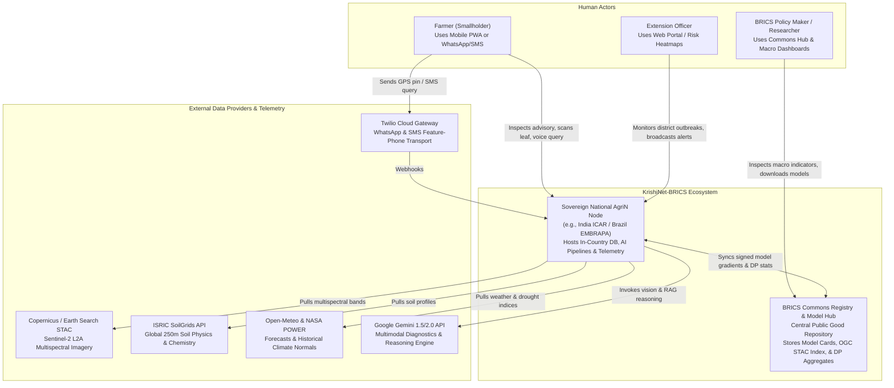
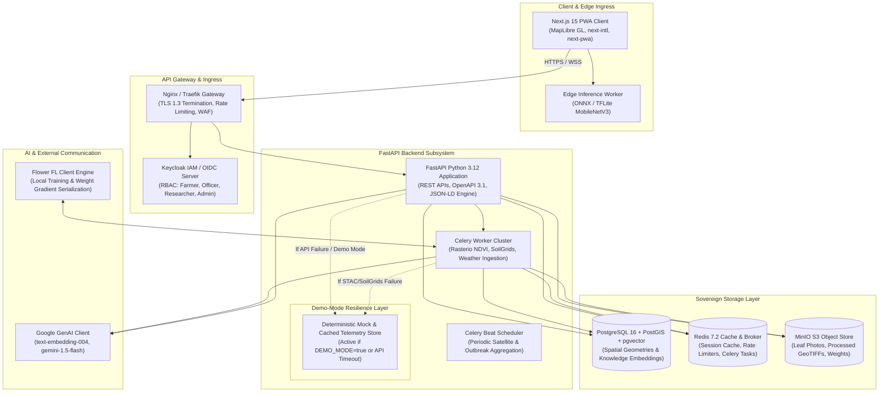
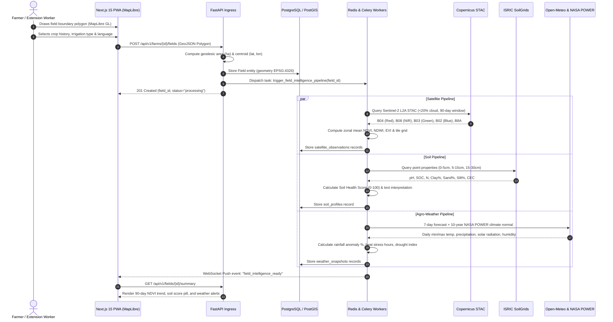
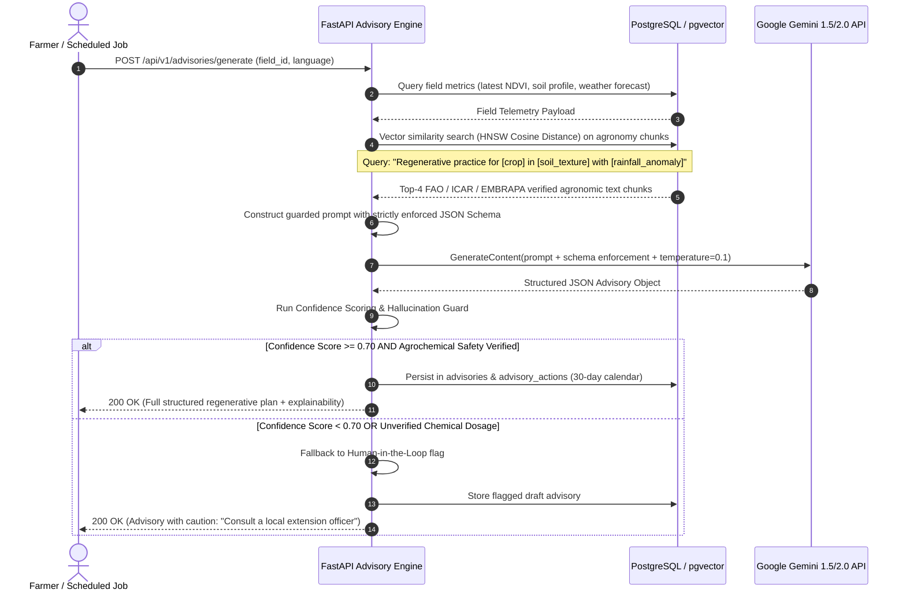
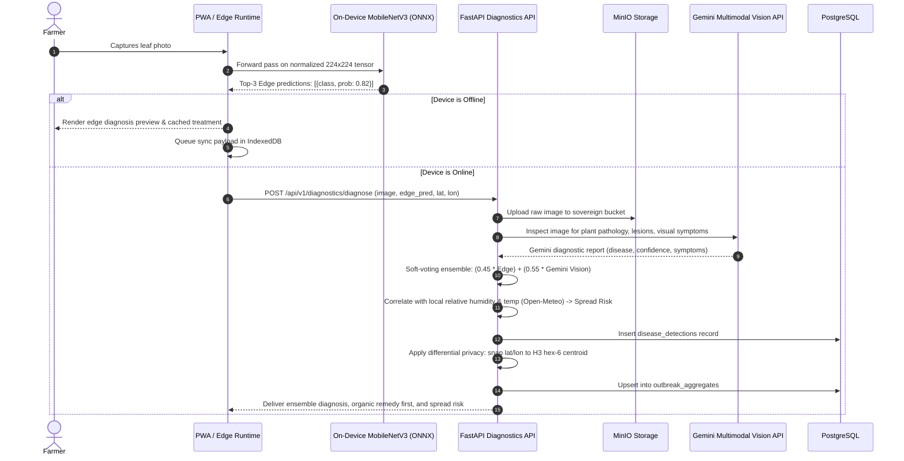
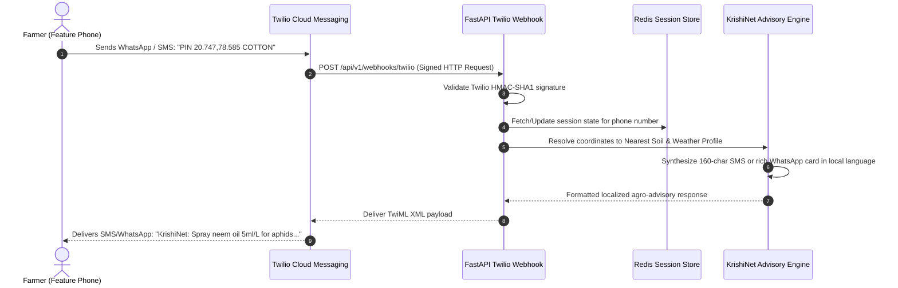
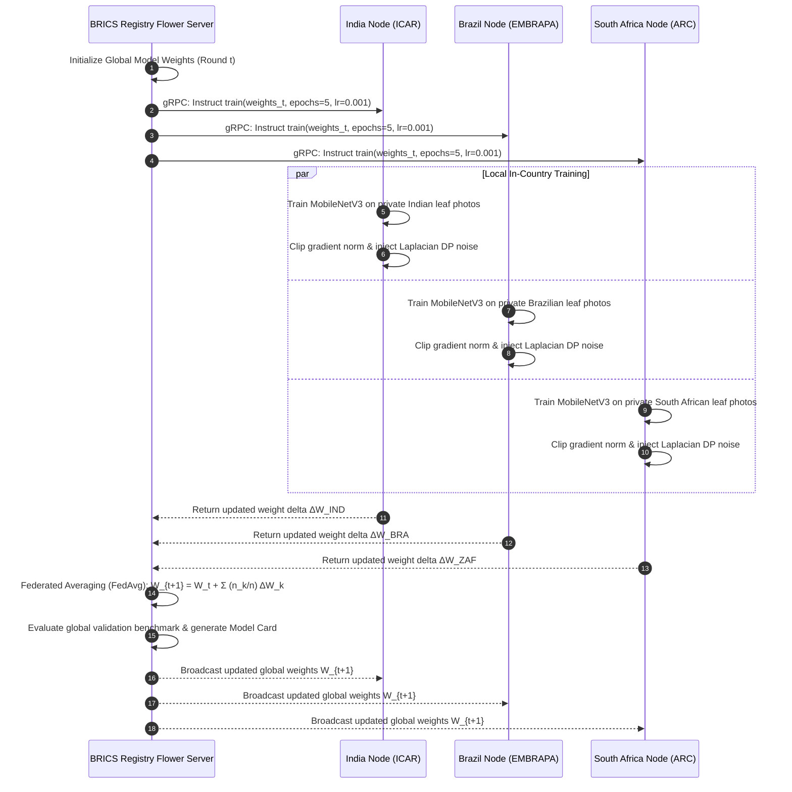
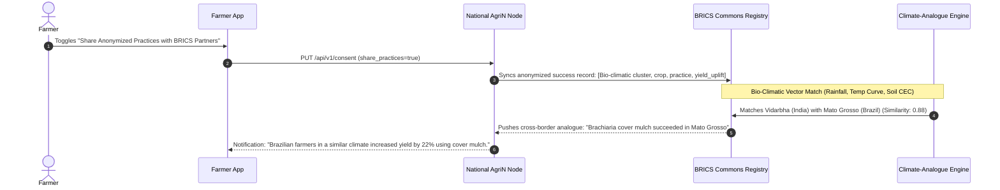
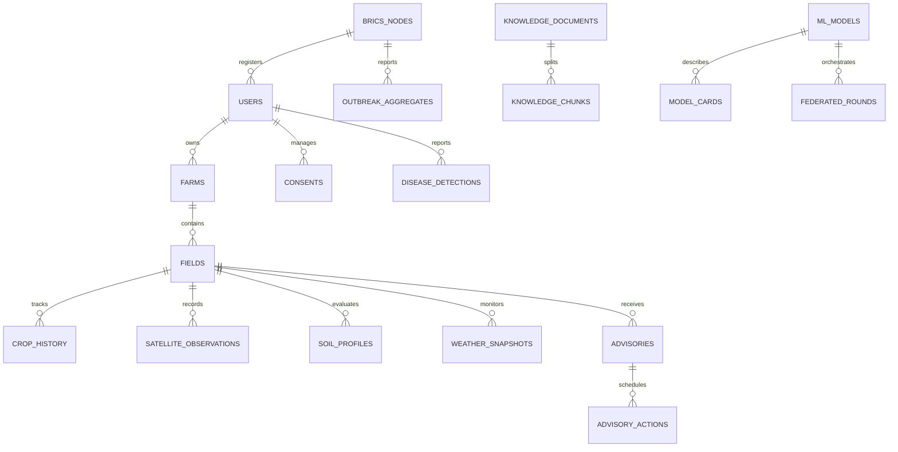

# KRISHINET-BRICS (AGRIN COMMONS)
## PHASE 1: COMPREHENSIVE SYSTEM ARCHITECTURE & TECHNICAL BLUEPRINT
**Theme:** Track 4 — AgriN & Regenerative Agricultural Intelligence | BRICS Theme: Cooperation  
**Tagline:** *"One field. Many nations. Shared intelligence."*

---

## 0. ASSUMPTIONS
1. **Sovereignty Boundary**: Raw farmer PII, exact cadastre boundaries, and un-noised farm sensor logs never leave the national host node; only differentially private metadata and model gradients cross borders.
2. **Offline Resilience**: Edge devices function fully disconnected via local IndexedDB storage and on-device quantized MobileNetV3 classifiers, syncing opportunistically.
3. **Demo Guarantee**: Every upstream API (Copernicus STAC, ISRIC SoilGrids, Open-Meteo, NASA POWER, Gemini API, Twilio) possesses an in-memory/cached fallback layer activated by `DEMO_MODE=true`.
4. **Coordinate & Semantic Standards**: Geospatial polygons use WGS84 (EPSG:4326); agronomic entities bind directly to FAO AGROVOC Concept URIs and OGC STAC schemas.
5. **Theme Rigidity**: UI strictly obeys the Green & White palette (`#FFFFFF` background, `#16A34A` brand primary, `#F4FAF5` surface-soft, `#DCEBDD` border) with WCAG AA compliance.

---

## 1. SYSTEM ARCHITECTURE

### 1.a C4-Style Context Diagram

*Explanation:* The Context diagram delineates user roles and organizational boundaries. Smallholders communicate directly with their Sovereign National AgriN Node via PWA or Twilio feature-phone SMS/WhatsApp gateways. The National Node orchestrates environmental enrichment and AI reasoning, communicating with the central BRICS Commons Registry only via anonymized model parameters and macro aggregates.

---

### 1.b Container Diagram for ONE Sovereign Country Node

*Explanation:* The single-node container architecture highlights internal component boundaries. The FastAPI engine routes asynchronous geospatial ingestion jobs through Redis to Celery workers. The critical `MockStorage` resilience engine intercepts all external failures, ensuring that even if third-party satellite, soil, or LLM services fail, the system serves high-fidelity deterministic agronomic calculations.

---

### 1.c Federated Topology Diagram (India, Brazil, South Africa + Registry)

```mermaid
graph TB
    subgraph BRICS_Registry ["BRICS COMMONS CENTRAL REGISTRY"]
        ModelHub["Global Model Hub<br/>(OCI Image Registry / S3 Weight Store)"]
        FlowerServer["Flower Central FL Server<br/>(FedAvg + Differential Privacy Clipping)"]
        STAC_Catalog["BRICS Federated STAC Catalog<br/>(Cross-Border Metadata Index)"]
        AnalogueEngine["Bio-Climatic Analogue Matcher<br/>(Köppen-Geiger & Soil Cluster Distance)"]
    end

    subgraph Node_IND ["Sovereign Node: INDIA (ICAR)"]
        DB_IND[("National PostGIS DB<br/>* Precise Cadastre Polygons<br/>* 850k Farmer Profiles<br/>* Raw Leaf Photos")]
        Worker_IND["Local Training & Ingestion"]
        Worker_IND --> DB_IND
    end

    subgraph Node_BRA ["Sovereign Node: BRAZIL (EMBRAPA)"]
        DB_BRA[("National PostGIS DB<br/>* Precise Cadastre Polygons<br/>* 420k Farmer Profiles<br/>* Raw Leaf Photos")]
        Worker_BRA["Local Training & Ingestion"]
        Worker_BRA --> DB_BRA
    end

    subgraph Node_ZAF ["Sovereign Node: SOUTH AFRICA (ARC)"]
        DB_ZAF[("National PostGIS DB<br/>* Precise Cadastre Polygons<br/>* 190k Farmer Profiles<br/>* Raw Leaf Photos")]
        Worker_ZAF["Local Training & Ingestion"]
        Worker_ZAF --> DB_ZAF
    end

    %% STRICT BOUNDARIES: WHAT CROSSES
    Worker_IND ==>|Weights & Gradients Only| FlowerServer
    Worker_BRA ==>|Weights & Gradients Only| FlowerServer
    Worker_ZAF ==>|Weights & Gradients Only| FlowerServer

    FlowerServer ==>|Aggregated Global Weights| ModelHub
    ModelHub -.->|Download Global Weights| Worker_IND
    ModelHub -.->|Download Global Weights| Worker_BRA
    ModelHub -.->|Download Global Weights| Worker_ZAF

    Worker_IND -->|H3 Hex-6 Noised Outbreak Aggregates| STAC_Catalog
    Worker_BRA -->|H3 Hex-6 Noised Outbreak Aggregates| STAC_Catalog
    Worker_ZAF -->|H3 Hex-6 Noised Outbreak Aggregates| STAC_Catalog

    AnalogueEngine -.->|Cross-Border Agronomy Match| Worker_IND
    AnalogueEngine -.->|Cross-Border Agronomy Match| Worker_BRA
    AnalogueEngine -.->|Cross-Border Agronomy Match| Worker_ZAF
```

*Explanation:* Sovereign country nodes maintain complete data isolation. Precise farm boundary vectors, raw leaf photography, and farmer identities remain strictly within their national borders. Only gradient tensors (protected with Laplacian differential privacy) and spatial disease outbreak aggregates (generalized to H3 resolution 6, ~36 km²) pass to the central registry.

---

## 2. DATA FLOW DIAGRAMS

### 2.a Farm Onboarding to Field Intelligence


### 2.b Advisory Generation (RAG + Gemini + Confidence Guard)


### 2.c Disease Diagnosis (Edge TFLite + Gemini Vision + Outbreak Logging)


### 2.d WhatsApp / SMS Advisory Flow (Twilio Gateway)


### 2.e Federated Learning Round with Flower


### 2.f Consent-Based Cross-Border Sharing & Climate-Analogue Matching


---

## 3. DATABASE SCHEMA (COMPLETE RUNNABLE POSTGRESQL SQL)

```sql
-- file: database/schema.sql
-- KrishiNet-BRICS Complete Database Schema Definition
-- PostgreSQL 16 + PostGIS + pgvector

CREATE EXTENSION IF NOT EXISTS "uuid-ossp";
CREATE EXTENSION IF NOT EXISTS "postgis";
CREATE EXTENSION IF NOT EXISTS "vector";

-- ============================================================================
-- 1. ENUMS & DOMAINS
-- ============================================================================
DO $$ BEGIN
    CREATE TYPE user_role_type AS ENUM ('farmer', 'extension_officer', 'government_admin', 'researcher');
    CREATE TYPE irrigation_system_type AS ENUM ('rainfed', 'drip', 'sprinkler', 'furrow', 'flood', 'subsurface');
    CREATE TYPE risk_severity_type AS ENUM ('low', 'moderate', 'high', 'severe');
    CREATE TYPE cost_level_type AS ENUM ('low', 'medium', 'high');
    CREATE TYPE message_channel_type AS ENUM ('whatsapp', 'sms', 'web_chat');
EXCEPTION
    WHEN duplicate_object THEN null;
END $$;

-- ============================================================================
-- 2. SOVEREIGN NODES, ORGANISATIONS & ROLES
-- ============================================================================
CREATE TABLE IF NOT EXISTS brics_nodes (
    country_iso VARCHAR(3) PRIMARY KEY,
    country_name VARCHAR(100) NOT NULL,
    lead_agency VARCHAR(255) NOT NULL,
    node_base_url VARCHAR(255) NOT NULL,
    public_x509_cert TEXT NOT NULL,
    is_active BOOLEAN DEFAULT TRUE,
    created_at TIMESTAMPTZ DEFAULT CURRENT_TIMESTAMP
);

CREATE TABLE IF NOT EXISTS organisations (
    id UUID PRIMARY KEY DEFAULT uuid_generate_v4(),
    country_iso VARCHAR(3) NOT NULL REFERENCES brics_nodes(country_iso),
    org_name VARCHAR(255) NOT NULL,
    org_type VARCHAR(64) NOT NULL, -- 'research_institute', 'extension_department', 'cooperative'
    contact_email VARCHAR(255),
    created_at TIMESTAMPTZ DEFAULT CURRENT_TIMESTAMP
);

CREATE TABLE IF NOT EXISTS users (
    id UUID PRIMARY KEY DEFAULT uuid_generate_v4(),
    country_iso VARCHAR(3) NOT NULL REFERENCES brics_nodes(country_iso),
    organisation_id UUID REFERENCES organisations(id) ON DELETE SET NULL,
    phone_number VARCHAR(32) UNIQUE,
    email VARCHAR(255) UNIQUE,
    password_hash VARCHAR(255),
    full_name VARCHAR(255) NOT NULL,
    preferred_language VARCHAR(10) DEFAULT 'en',
    role user_role_type DEFAULT 'farmer',
    keycloak_sub UUID UNIQUE,
    is_verified BOOLEAN DEFAULT FALSE,
    created_at TIMESTAMPTZ DEFAULT CURRENT_TIMESTAMP,
    updated_at TIMESTAMPTZ DEFAULT CURRENT_TIMESTAMP
);

-- ============================================================================
-- 3. FARMS, SPATIAL FIELDS & CROP HISTORY
-- ============================================================================
CREATE TABLE IF NOT EXISTS farms (
    id UUID PRIMARY KEY DEFAULT uuid_generate_v4(),
    user_id UUID NOT NULL REFERENCES users(id) ON DELETE CASCADE,
    farm_name VARCHAR(255) NOT NULL,
    village_district VARCHAR(255),
    state_province VARCHAR(255) NOT NULL,
    country_iso VARCHAR(3) NOT NULL REFERENCES brics_nodes(country_iso),
    total_area_hectares NUMERIC(10, 4) NOT NULL DEFAULT 0.0,
    created_at TIMESTAMPTZ DEFAULT CURRENT_TIMESTAMP
);

CREATE TABLE IF NOT EXISTS fields (
    id UUID PRIMARY KEY DEFAULT uuid_generate_v4(),
    farm_id UUID NOT NULL REFERENCES farms(id) ON DELETE CASCADE,
    field_name VARCHAR(100) NOT NULL,
    boundary GEOMETRY(Polygon, 4326) NOT NULL,
    centroid GEOMETRY(Point, 4326) GENERATED ALWAYS AS (ST_Centroid(boundary)) STORED,
    area_hectares NUMERIC(10, 4) NOT NULL,
    irrigation_type irrigation_system_type DEFAULT 'rainfed',
    current_crop VARCHAR(100),
    sowing_date DATE,
    created_at TIMESTAMPTZ DEFAULT CURRENT_TIMESTAMP,
    updated_at TIMESTAMPTZ DEFAULT CURRENT_TIMESTAMP
);

CREATE INDEX IF NOT EXISTS idx_fields_boundary ON fields USING GIST(boundary);
CREATE INDEX IF NOT EXISTS idx_fields_centroid ON fields USING GIST(centroid);
CREATE INDEX IF NOT EXISTS idx_fields_farm_id ON fields(farm_id);

CREATE TABLE IF NOT EXISTS crop_history (
    id UUID PRIMARY KEY DEFAULT uuid_generate_v4(),
    field_id UUID NOT NULL REFERENCES fields(id) ON DELETE CASCADE,
    crop_name VARCHAR(100) NOT NULL,
    fao_agrovoc_uri VARCHAR(255),
    season_name VARCHAR(64) NOT NULL, -- 'kharif_2025', 'safra_2024'
    sowing_date DATE,
    harvest_date DATE,
    yield_kg_ha NUMERIC(10, 2),
    fertilizers_applied JSONB DEFAULT '[]'::jsonb,
    created_at TIMESTAMPTZ DEFAULT CURRENT_TIMESTAMP
);

CREATE INDEX IF NOT EXISTS idx_crop_history_field ON crop_history(field_id);

-- ============================================================================
-- 4. SATELLITE, SOIL & WEATHER TELEMETRY
-- ============================================================================
CREATE TABLE IF NOT EXISTS satellite_observations (
    id UUID PRIMARY KEY DEFAULT uuid_generate_v4(),
    field_id UUID NOT NULL REFERENCES fields(id) ON DELETE CASCADE,
    acquisition_date TIMESTAMPTZ NOT NULL,
    satellite_name VARCHAR(64) DEFAULT 'Sentinel-2 L2A',
    cloud_cover_pct NUMERIC(5, 2) NOT NULL,
    mean_ndvi NUMERIC(6, 4) NOT NULL,
    p10_ndvi NUMERIC(6, 4),
    p90_ndvi NUMERIC(6, 4),
    mean_ndwi NUMERIC(6, 4) NOT NULL,
    mean_evi NUMERIC(6, 4) NOT NULL,
    raw_tile_geojson JSONB,
    s3_storage_key VARCHAR(512),
    created_at TIMESTAMPTZ DEFAULT CURRENT_TIMESTAMP
);

CREATE INDEX IF NOT EXISTS idx_sat_field_date ON satellite_observations(field_id, acquisition_date DESC);

CREATE TABLE IF NOT EXISTS soil_profiles (
    id UUID PRIMARY KEY DEFAULT uuid_generate_v4(),
    field_id UUID NOT NULL REFERENCES fields(id) ON DELETE CASCADE,
    data_source VARCHAR(64) DEFAULT 'ISRIC SoilGrids 250m v2.0',
    depth_interval VARCHAR(32) DEFAULT '0-30cm',
    ph_h2o NUMERIC(4, 2) NOT NULL,
    soil_organic_carbon_g_kg NUMERIC(6, 2) NOT NULL,
    nitrogen_total_g_kg NUMERIC(6, 2),
    cation_exchange_capacity_cmol_kg NUMERIC(6, 2),
    clay_pct NUMERIC(5, 2) NOT NULL,
    sand_pct NUMERIC(5, 2) NOT NULL,
    silt_pct NUMERIC(5, 2) NOT NULL,
    bulk_density_cg_cm3 NUMERIC(5, 2),
    soil_health_score INTEGER CHECK (soil_health_score BETWEEN 0 AND 100),
    plain_language_interpretation TEXT NOT NULL,
    sampled_at TIMESTAMPTZ DEFAULT CURRENT_TIMESTAMP
);

CREATE INDEX IF NOT EXISTS idx_soil_field ON soil_profiles(field_id);

CREATE TABLE IF NOT EXISTS weather_snapshots (
    id UUID PRIMARY KEY DEFAULT uuid_generate_v4(),
    field_id UUID NOT NULL REFERENCES fields(id) ON DELETE CASCADE,
    snapshot_date DATE NOT NULL,
    temp_min_c NUMERIC(5, 2) NOT NULL,
    temp_max_c NUMERIC(5, 2) NOT NULL,
    precipitation_mm NUMERIC(6, 2) NOT NULL,
    relative_humidity_pct NUMERIC(5, 2) NOT NULL,
    wind_speed_kmh NUMERIC(5, 2),
    rainfall_anomaly_pct NUMERIC(6, 2),
    heat_stress_hours INTEGER DEFAULT 0,
    frost_risk_detected BOOLEAN DEFAULT FALSE,
    drought_spei_index NUMERIC(5, 3),
    forecast_type VARCHAR(32) DEFAULT '7day_forecast',
    created_at TIMESTAMPTZ DEFAULT CURRENT_TIMESTAMP
);

CREATE INDEX IF NOT EXISTS idx_weather_field_date ON weather_snapshots(field_id, snapshot_date DESC);

-- ============================================================================
-- 5. AGRONOMIC KNOWLEDGE BASE & pgvector
-- ============================================================================
CREATE TABLE IF NOT EXISTS knowledge_documents (
    id UUID PRIMARY KEY DEFAULT uuid_generate_v4(),
    title VARCHAR(255) NOT NULL,
    publishing_agency VARCHAR(100) NOT NULL, -- FAO, ICAR, EMBRAPA, CAAS
    source_url VARCHAR(512),
    license_type VARCHAR(64) DEFAULT 'CC-BY-4.0',
    created_at TIMESTAMPTZ DEFAULT CURRENT_TIMESTAMP
);

CREATE TABLE IF NOT EXISTS knowledge_chunks (
    id UUID PRIMARY KEY DEFAULT uuid_generate_v4(),
    document_id UUID NOT NULL REFERENCES knowledge_documents(id) ON DELETE CASCADE,
    chunk_index INTEGER NOT NULL,
    content_text TEXT NOT NULL,
    fao_agrovoc_concept VARCHAR(255),
    target_crop VARCHAR(100),
    climate_zone VARCHAR(100),
    embedding VECTOR(768) NOT NULL, -- text-embedding-004
    metadata_json JSONB DEFAULT '{}'::jsonb
);

CREATE INDEX IF NOT EXISTS idx_chunks_hnsw_embedding 
ON knowledge_chunks USING hnsw (embedding vector_cosine_ops);

-- ============================================================================
-- 6. REGENERATIVE ADVISORIES & 30-DAY ACTION CALENDAR
-- ============================================================================
CREATE TABLE IF NOT EXISTS advisories (
    id UUID PRIMARY KEY DEFAULT uuid_generate_v4(),
    field_id UUID NOT NULL REFERENCES fields(id) ON DELETE CASCADE,
    confidence_score NUMERIC(4, 3) NOT NULL,
    hallucination_guard_passed BOOLEAN DEFAULT TRUE,
    top_3_crops JSONB NOT NULL,
    regenerative_practices JSONB NOT NULL,
    sowing_window JSONB NOT NULL,
    irrigation_schedule JSONB NOT NULL,
    organic_fertilizer_plan JSONB NOT NULL,
    explainability_signals JSONB NOT NULL,
    carbon_sequestration_t_ha NUMERIC(6, 3),
    water_saved_pct INTEGER,
    yield_uplift_pct INTEGER,
    disclaimer_note TEXT NOT NULL,
    created_at TIMESTAMPTZ DEFAULT CURRENT_TIMESTAMP
);

CREATE INDEX IF NOT EXISTS idx_advisories_field ON advisories(field_id, created_at DESC);

CREATE TABLE IF NOT EXISTS advisory_actions (
    id UUID PRIMARY KEY DEFAULT uuid_generate_v4(),
    advisory_id UUID NOT NULL REFERENCES advisories(id) ON DELETE CASCADE,
    calendar_day INTEGER NOT NULL, -- 1 to 30
    action_title VARCHAR(255) NOT NULL,
    action_description TEXT NOT NULL,
    category VARCHAR(64) NOT NULL, -- 'soil', 'irrigation', 'ipm', 'sowing'
    is_completed BOOLEAN DEFAULT FALSE,
    completed_at TIMESTAMPTZ
);

CREATE INDEX IF NOT EXISTS idx_actions_advisory ON advisory_actions(advisory_id, calendar_day);

-- ============================================================================
-- 7. CROP DISEASE DIAGNOSTICS & OUTBREAK AGGREGATION
-- ============================================================================
CREATE TABLE IF NOT EXISTS disease_detections (
    id UUID PRIMARY KEY DEFAULT uuid_generate_v4(),
    farmer_id UUID NOT NULL REFERENCES users(id) ON DELETE CASCADE,
    field_id UUID REFERENCES fields(id) ON DELETE SET NULL,
    image_s3_uri VARCHAR(512) NOT NULL,
    edge_prediction JSONB,
    gemini_vision_prediction JSONB,
    ensemble_prediction JSONB NOT NULL,
    primary_disease_name VARCHAR(150) NOT NULL,
    fao_agrovoc_uri VARCHAR(255),
    severity_level VARCHAR(32) NOT NULL,
    organic_treatment TEXT NOT NULL,
    chemical_treatment TEXT,
    chemical_safety_warning TEXT,
    prevention_measures TEXT[] NOT NULL,
    spread_risk_score risk_severity_type DEFAULT 'low',
    location_point GEOMETRY(Point, 4326) NOT NULL,
    created_at TIMESTAMPTZ DEFAULT CURRENT_TIMESTAMP
);

CREATE INDEX IF NOT EXISTS idx_disease_geo ON disease_detections USING GIST(location_point);

CREATE TABLE IF NOT EXISTS outbreak_aggregates (
    id UUID PRIMARY KEY DEFAULT uuid_generate_v4(),
    country_iso VARCHAR(3) NOT NULL REFERENCES brics_nodes(country_iso),
    disease_name VARCHAR(150) NOT NULL,
    affected_crop VARCHAR(100) NOT NULL,
    incident_count INTEGER NOT NULL,
    risk_severity risk_severity_type DEFAULT 'moderate',
    h3_hex_index VARCHAR(32) NOT NULL,
    centroid_geom GEOMETRY(Point, 4326) NOT NULL,
    period_start TIMESTAMPTZ NOT NULL,
    period_end TIMESTAMPTZ NOT NULL
);

CREATE INDEX IF NOT EXISTS idx_outbreaks_h3 ON outbreak_aggregates(h3_hex_index);
CREATE INDEX IF NOT EXISTS idx_outbreaks_geom ON outbreak_aggregates USING GIST(centroid_geom);

-- ============================================================================
-- 8. MODEL HUB, FEDERATED ROUNDS & CONSENT
-- ============================================================================
CREATE TABLE IF NOT EXISTS ml_models (
    id UUID PRIMARY KEY DEFAULT uuid_generate_v4(),
    model_name VARCHAR(150) NOT NULL,
    task_type VARCHAR(64) NOT NULL,
    license_type VARCHAR(64) DEFAULT 'Apache-2.0',
    dpg_compliant BOOLEAN DEFAULT TRUE,
    created_at TIMESTAMPTZ DEFAULT CURRENT_TIMESTAMP
);

CREATE TABLE IF NOT EXISTS model_cards (
    id UUID PRIMARY KEY DEFAULT uuid_generate_v4(),
    model_id UUID NOT NULL REFERENCES ml_models(id) ON DELETE CASCADE,
    version_tag VARCHAR(32) NOT NULL,
    accuracy_score NUMERIC(5, 4) NOT NULL,
    f1_score NUMERIC(5, 4),
    training_data_summary TEXT NOT NULL,
    bias_limitations TEXT NOT NULL,
    s3_weights_uri VARCHAR(512) NOT NULL,
    weights_sha256 VARCHAR(64) NOT NULL,
    card_markdown TEXT NOT NULL,
    published_at TIMESTAMPTZ DEFAULT CURRENT_TIMESTAMP
);

CREATE TABLE IF NOT EXISTS federated_rounds (
    id UUID PRIMARY KEY DEFAULT uuid_generate_v4(),
    model_id UUID NOT NULL REFERENCES ml_models(id) ON DELETE CASCADE,
    round_number INTEGER NOT NULL,
    participating_nodes VARCHAR(3)[] NOT NULL,
    aggregation_strategy VARCHAR(64) DEFAULT 'FedAvg-DP',
    epsilon_privacy_budget NUMERIC(5, 3) DEFAULT 0.500,
    started_at TIMESTAMPTZ DEFAULT CURRENT_TIMESTAMP,
    completed_at TIMESTAMPTZ
);

CREATE TABLE IF NOT EXISTS consents (
    id UUID PRIMARY KEY DEFAULT uuid_generate_v4(),
    user_id UUID NOT NULL REFERENCES users(id) ON DELETE CASCADE,
    share_anonymized_soil BOOLEAN DEFAULT TRUE,
    share_outbreak_telemetry BOOLEAN DEFAULT TRUE,
    participate_in_federated_learning BOOLEAN DEFAULT TRUE,
    updated_at TIMESTAMPTZ DEFAULT CURRENT_TIMESTAMP
);

CREATE TABLE IF NOT EXISTS data_sharing_agreements (
    id UUID PRIMARY KEY DEFAULT uuid_generate_v4(),
    signatory_country VARCHAR(3) NOT NULL REFERENCES brics_nodes(country_iso),
    agreement_title VARCHAR(255) NOT NULL,
    terms_url VARCHAR(512) NOT NULL,
    is_active BOOLEAN DEFAULT TRUE,
    ratified_at TIMESTAMPTZ DEFAULT CURRENT_TIMESTAMP
);

-- ============================================================================
-- 9. CLIMATE ANALOGUES, IMPACT, AUDIT & MESSAGING
-- ============================================================================
CREATE TABLE IF NOT EXISTS climate_analogues (
    id UUID PRIMARY KEY DEFAULT uuid_generate_v4(),
    source_region VARCHAR(150) NOT NULL,
    source_country VARCHAR(3) NOT NULL,
    analogue_region VARCHAR(150) NOT NULL,
    analogue_country VARCHAR(3) NOT NULL,
    similarity_index NUMERIC(4, 3) NOT NULL,
    successful_regenerative_practices JSONB NOT NULL,
    created_at TIMESTAMPTZ DEFAULT CURRENT_TIMESTAMP
);

CREATE TABLE IF NOT EXISTS impact_metrics (
    id UUID PRIMARY KEY DEFAULT uuid_generate_v4(),
    country_iso VARCHAR(3) NOT NULL REFERENCES brics_nodes(country_iso),
    recorded_date DATE NOT NULL,
    active_farmers_count INTEGER NOT NULL,
    total_area_under_regeneration_ha NUMERIC(12, 2) NOT NULL,
    estimated_water_saved_m3 NUMERIC(14, 2) NOT NULL,
    estimated_co2e_sequestered_tonnes NUMERIC(12, 2) NOT NULL,
    created_at TIMESTAMPTZ DEFAULT CURRENT_TIMESTAMP
);

CREATE TABLE IF NOT EXISTS notifications (
    id UUID PRIMARY KEY DEFAULT uuid_generate_v4(),
    user_id UUID NOT NULL REFERENCES users(id) ON DELETE CASCADE,
    title VARCHAR(255) NOT NULL,
    body TEXT NOT NULL,
    notification_type VARCHAR(64) NOT NULL,
    is_read BOOLEAN DEFAULT FALSE,
    created_at TIMESTAMPTZ DEFAULT CURRENT_TIMESTAMP
);

CREATE TABLE IF NOT EXISTS audit_logs (
    id UUID PRIMARY KEY DEFAULT uuid_generate_v4(),
    user_id UUID REFERENCES users(id) ON DELETE SET NULL,
    action VARCHAR(128) NOT NULL,
    resource_type VARCHAR(64) NOT NULL,
    resource_id VARCHAR(64),
    client_ip VARCHAR(45),
    timestamp TIMESTAMPTZ DEFAULT CURRENT_TIMESTAMP
);

CREATE TABLE IF NOT EXISTS message_sessions (
    id UUID PRIMARY KEY DEFAULT uuid_generate_v4(),
    phone_number VARCHAR(32) NOT NULL,
    channel message_channel_type NOT NULL,
    session_state JSONB DEFAULT '{}'::jsonb,
    last_interaction TIMESTAMPTZ DEFAULT CURRENT_TIMESTAMP
);
CREATE INDEX IF NOT EXISTS idx_msg_sessions_phone ON message_sessions(phone_number);
```

### Entity-Relationship (ER) Diagram


---

## 4. API ENDPOINT LIST (OPENAPI 3.1 SUMMARY)

### Group 1: Authentication & Node Identity
| Method | Path | Purpose | Role | Request / Response |
| :--- | :--- | :--- | :--- | :--- |
| `POST` | `/api/v1/auth/register` | Register farmer / officer account | Public | Body: `UserCreate` -> `TokenResponse` |
| `POST` | `/api/v1/auth/login` | Login via password / OTP demo | Public | Body: `UserLogin` -> `TokenResponse` |
| `GET` | `/api/v1/auth/me` | Fetch active user profile & consents | Authenticated | Response: `UserResponse` |

### Group 2: Farms & Spatial Fields
| Method | Path | Purpose | Role | Request / Response |
| :--- | :--- | :--- | :--- | :--- |
| `POST` | `/api/v1/farms` | Create farm boundary envelope | Farmer, Officer | Body: `FarmCreate` -> `FarmResponse` |
| `GET` | `/api/v1/farms` | List user farms | Farmer, Officer | Response: `List<FarmResponse>` |
| `POST` | `/api/v1/farms/{id}/fields`| Onboard field with GeoJSON polygon | Farmer, Officer | Body: `FieldCreate` (GeoJSON) -> `FieldResponse` |
| `GET` | `/api/v1/fields/{id}` | Get spatial field geometry & details| Farmer, Officer | Response: `FieldResponse` |

### Group 3: Field Intelligence (Satellite, Soil, Weather)
| Method | Path | Purpose | Role | Request / Response |
| :--- | :--- | :--- | :--- | :--- |
| `GET` | `/api/v1/fields/{id}/satellite`| 90-day NDVI/NDWI/EVI timeseries | Farmer, Officer | Params: `?days=90` -> `List<SatelliteMetricResponse>`|
| `GET` | `/api/v1/fields/{id}/soil` | ISRIC SoilGrids profile & Score | Farmer, Officer | Response: `SoilProfileResponse` |
| `GET` | `/api/v1/fields/{id}/weather`| 7-day forecast & climate risks | Farmer, Officer | Params: `?horizon=7` -> `List<WeatherRecordResponse>`|

### Group 4: AI Regenerative Advisory
| Method | Path | Purpose | Role | Request / Response |
| :--- | :--- | :--- | :--- | :--- |
| `POST` | `/api/v1/advisories/generate`| Generate AI Regenerative Advisory | Farmer, Officer | Body: `AdvisoryGenerateRequest` -> `AdvisoryResponse` |
| `GET` | `/api/v1/advisories/{id}/calendar`| Fetch 30-day action calendar | Farmer, Officer | Response: `List<AdvisoryActionResponse>` |
| `GET` | `/api/v1/advisories/{id}/explain` | Explainability: cite signals & logic| Farmer, Officer | Response: `ExplainabilitySignalsResponse` |

### Group 5: Disease Diagnostics & Outbreaks
| Method | Path | Purpose | Role | Request / Response |
| :--- | :--- | :--- | :--- | :--- |
| `POST` | `/api/v1/diagnostics/diagnose`| Edge + Gemini Vision Leaf Diagnosis| Farmer, Officer | Multipart Form (`image`, `lat`, `lon`) -> `DiseaseDiagnosticResponse` |
| `GET` | `/api/v1/diagnostics/outbreaks`| Regional disease outbreak heatmap | Public / Officer| Params: `?country=IND&h3_res=6` -> `FeatureCollection` |

### Group 6: Knowledge Base & RAG Admin
| Method | Path | Purpose | Role | Request / Response |
| :--- | :--- | :--- | :--- | :--- |
| `POST` | `/api/v1/rag/documents` | Ingest agronomy guide (FAO/ICAR) | Researcher, Admin| Body: `DocumentIngestRequest` -> `IngestSummary` |
| `POST` | `/api/v1/rag/search` | Query knowledge chunks via vector | Researcher, Admin| Body: `VectorQuery` -> `List<ChunkMatch>` |

### Group 7: BRICS Interoperability, Model Hub & STAC
| Method | Path | Purpose | Role | Request / Response |
| :--- | :--- | :--- | :--- | :--- |
| `GET` | `/api/v1/brics/stac/catalog` | OGC STAC compliant catalog index | Public | Response: `STACItemCollection` |
| `GET` | `/api/v1/brics/agrovoc/terms` | Resolve FAO AGROVOC JSON-LD terms| Public | Params: `?term=sorghum` -> `JSONLDTerm` |
| `GET` | `/api/v1/brics/models` | List federated models & model cards| Public / Researcher| Response: `List<ModelCardResponse>` |
| `GET` | `/api/v1/brics/climate-analogues`| Climate-analogue matching search | Farmer, Officer, Policy| Params: `?field_id={id}` -> `ClimateAnalogueResponse`|

### Group 8: Consent, Messaging Webhooks & System Health
| Method | Path | Purpose | Role | Request / Response |
| :--- | :--- | :--- | :--- | :--- |
| `PUT` | `/api/v1/auth/consent` | Update data-sharing permissions | Authenticated | Body: `ConsentUpdate` -> `StatusResponse` |
| `POST` | `/api/v1/webhooks/twilio` | WhatsApp & SMS Webhook Ingress | Twilio Gateway | Form URL-encoded -> TwiML XML |
| `GET` | `/api/v1/impact/summary` | Global regenerative impact counters| Public | Params: `?country=ALL` -> `ImpactMetricsResponse`|
| `GET` | `/health` / `/api/health`| Liveness & readiness probes | Public | Response: `HealthCheckResponse` |

---

## 5. AI PIPELINE DESIGN

### 5.a Advisory Structured JSON Schema (Pydantic Contract)
```python
from pydantic import BaseModel, Field
from typing import List, Dict, Optional

class RegenerativePracticeItem(BaseModel):
    practice_name: str = Field(..., description="e.g. Cover Cropping, Biochar, Reduced Tillage")
    fao_category: str = Field(..., description="FAO Conservation Agriculture category")
    description: str
    cost_level: str = Field(..., regex="^(low|medium|high)$")
    soil_benefit: str
    carbon_benefit: str
    implementation_steps: List[str]

class CropRecommendationItem(BaseModel):
    crop_name: str
    scientific_name: str
    suitability_score: float = Field(..., ge=0.0, le=1.0)
    expected_yield_range: str
    water_need_mm: int
    climate_risk_rating: str = Field(..., regex="^(low|moderate|high)$")

class SowingWindowPlan(BaseModel):
    optimal_start_date: str
    optimal_end_date: str
    trigger_condition: str

class AdvisoryActionItem(BaseModel):
    day: int = Field(..., ge=1, le=30)
    task: str
    category: str

class RegenerativeAdvisoryPayload(BaseModel):
    confidence_score: float = Field(..., ge=0.0, le=1.0)
    top_3_crops: List[CropRecommendationItem]
    regenerative_practices: List[RegenerativePracticeItem]
    sowing_window: SowingWindowPlan
    irrigation_schedule: Dict[str, str]
    organic_fertilizer_plan: Dict[str, str]
    action_calendar_30days: List[AdvisoryActionItem]
    explainability_signals: Dict[str, str]
    estimated_carbon_sequestration_t_ha: float
    estimated_water_saved_pct: int
    estimated_yield_uplift_pct: int
    disclaimer_notice: str
```

### 5.b Disease Result Schema
```python
class DiseaseDiagnosticPayload(BaseModel):
    primary_disease_name: str
    fao_agrovoc_uri: Optional[str]
    severity_rating: str = Field(..., regex="^(mild|moderate|critical)$")
    confidence: float = Field(..., ge=0.0, le=1.0)
    top_predictions: List[Dict[str, float]]
    organic_treatment: str
    chemical_treatment: Optional[str]
    chemical_safety_warning: Optional[str]
    prevention_measures: List[str]
    spread_risk_level: str = Field(..., regex="^(low|moderate|high|severe)$")
```

### 5.c RAG Chunking & Embedding Strategy
- **Embedding Model**: Google `text-embedding-004` (768-dimensional output vector).
- **Chunking Parameters**: Recursive character chunking: 512 tokens with 64 token overlap, splitting strictly on paragraph and markdown header boundaries.
- **Metadata Tagging**: Each chunk is annotated with `{ agency: "FAO|ICAR|EMBRAPA", crop: "cotton", climate: "semi-arid", practice: "cover-crop" }`.
- **Retrieval Metric**: Cosine similarity (`1 - (vector <=> embedding)`) using PostgreSQL pgvector `hnsw` index (`m=16, ef_construction=64`). Top-4 chunks ($k=4$) retrieved with distance threshold $< 0.35$.

### 5.d Prompt Structure & Hallucination Guard Rules
1. **System Prompt**: Enforces agronomist persona, biological safety constraints, and strictly forbids unauthorized chemical concoctions.
2. **Confidence Formula**:
   $$\text{Confidence} = 0.35 \cdot S_{\text{sat}} + 0.30 \cdot S_{\text{soil}} + 0.20 \cdot S_{\text{weather}} + 0.15 \cdot S_{\text{RAG\_similarity}}$$
   - Where each sub-score $S \in [0, 1]$ represents signal quality/freshness.
3. **Guard Threshold**:
   - If $\text{Confidence} < 0.70$: Replace actionable chemical dosages with standardized advisory: *"Confidence threshold below verified limit. Consult a local agricultural extension officer."*
   - Never output synthetic chemical recommendations without pairing them with certified organic remedies and PPE warnings.

### 5.e Soil Health Score Formula
The overall Soil Health Score (0–100) is calculated via normalized agronomic sub-indices:
$$\text{Score} = 100 \times \left( 0.25 \cdot I_{\text{pH}} + 0.30 \cdot I_{\text{SOC}} + 0.20 \cdot I_{\text{N}} + 0.15 \cdot I_{\text{CEC}} + 0.10 \cdot I_{\text{BD}} \right)$$
- $I_{\text{pH}}$: Optimal between 6.5 and 7.5 (bell-curve scoring).
- $I_{\text{SOC}}$: Soil Organic Carbon (optimal $\ge 20\text{ g/kg} \implies 1.0$; linear penalty below).
- $I_{\text{N}}$: Total nitrogen availability index.
- $I_{\text{CEC}}$: Cation Exchange Capacity (optimal $\ge 25\text{ cmol/kg} \implies 1.0$).
- $I_{\text{BD}}$: Bulk density penalty (penalizes compaction $> 1.4\text{ g/cm}^3$).

---

## 6. FEDERATED NODE DESIGN

1. **Node Deployment Unit**: Packaged as a sovereign multi-container Docker Compose / Helm chart containing FastAPI, PostgreSQL (PostGIS+pgvector), Redis, Celery, and MinIO.
2. **Registry Handshake & Signed Metadata**: Nodes authenticate to the BRICS Registry via Mutual TLS (mTLS) with Ed25519 public key verification. Nodes publish signed JSON-LD catalog records validating origin.
3. **Data Boundary Rule**:
   - **Local Only**: Farm boundaries, farmer names/phones, leaf images, micro-level sensor logs.
   - **Cross-Border**: Aggregated model weight deltas ($\Delta W$), H3 hexagonal disease outbreak counts with Laplacian noise, and anonymized agro-climatic practice success metrics.
4. **Model Exchange Protocol**: Models are packaged as Open Container Initiative (OCI) artifacts or S3 signed assets. Flower clients communicate via gRPC over TLS with tokenized authorization.
5. **Differential Privacy Guarantee**: Laplacian noise ($\epsilon = 0.5, \delta = 10^{-5}$) added to model updates and outbreak centroids. Gradient clipping norm $C = 1.0$.
6. **1-Day Country Onboarding**: A new nation provisions a node via `git clone`, fills `.env` with sovereign agency credentials, and executes `docker compose up -d`. Node auto-registers its public key with the BRICS Commons Registry via an automated onboarding handshake endpoint.

---

## 7. FOLDER STRUCTURE (MONOREPO)

```
krishinet-brics/
├── apps/
│   └── web/                           # Next.js 15 PWA frontend with MapLibre & green-white theme
├── services/
│   ├── api/                           # FastAPI backend REST services & JSON-LD endpoints
│   ├── workers/                       # Celery worker cluster for rasterio, STAC, & weather jobs
│   └── ml/                            # Edge ONNX export scripts & Flower federated learning clients
├── infra/
│   ├── docker/                        # Docker Compose stacks (dev, demo, sovereign-node)
│   └── k8s/                           # Kubernetes manifests & Helm charts for production deployment
├── packages/
│   └── shared/                        # Shared TypeScript & Python contracts (GeoJSON, DPG schemas)
├── docs/
│   └── architecture/                  # Architectural diagrams, threat models, & ADRs
├── scripts/
│   ├── seed_demo_data.py              # Seeds 3 demo farms (India, Brazil, South Africa)
│   └── test_offline_sync.py           # Validates PWA queue & edge inference sync
└── data/
    └── seed/                          # Sample leaf disease imagery, SoilGrids rasters, & FAO guides
```

---

## 8. THREAT MODEL SUMMARY (STRIDE FRAMEWORK)

| Threat Type | Asset at Risk | Severity | Concrete Architectural Mitigation |
| :--- | :--- | :--- | :--- |
| **Spoofing** | Extension Officer Broadcasts | High | Mutual TLS, Keycloak OIDC RBAC, and multi-signature authorization for mass alerts. |
| **Tampering** | Satellite Rasters / Model Weights | High | SHA-256 hash validation on all STAC raster tiles; signed model card digests. |
| **Repudiation** | Cross-Border Shared Telemetry | Medium | Immutable cryptographic audit log (`audit_logs`) tracking model publications. |
| **Information Disclosure** | Farmer Location & Cadastre | Critical | Raw spatial boundaries retained strictly within national database; H3 resolution 6 noising. |
| **Denial of Service** | Rural Ingress & Advisory Engine | High | Offline-first PWA caching; Redis token-bucket rate limiting; deterministic demo fallback. |
| **Elevation of Privilege**| Policy Maker Admin Controls | High | FastAPI dependency injection enforcing role claims (`require_roles(["admin"])`). |

### Deep-Dive Mitigations
- **Farmer Privacy**: Coordinates are truncated and jittered prior to outbreak map publishing.
- **Prompt Injection**: User input is strictly cast through typed Pydantic models before prompt assembly; system prompts enforce structural JSON constraints.
- **Model Poisoning**: Federated learning uses Byzantine-robust Trimmed Mean aggregation rather than pure FedAvg, discarding outlier gradient updates.
- **Twilio Webhook Spoofing**: All webhook requests are checked against the `X-Twilio-Signature` HMAC-SHA1 header.

---

## 9. UI WIREFRAME DESCRIPTIONS (GREEN & WHITE THEME)

### 9.a Farm Onboarding Map
- **Layout**: Full-screen MapLibre GL canvas with floating white cards.
- **Components**: Polygon drawing toolbar (draw, edit, trash, GPS pin), 60-second quick-form modal (crop history, irrigation chip-select).
- **States**: Loading (green-tinted pulse skeleton), Error (soft red pill with retry), Success (green border flash).
- **Mobile vs Desktop**: Mobile has a bottom drawer sheet; desktop has a 380px collapsible white sidebar.

### 9.b Farmer Dashboard
- **Layout**: Single-column vertical scroll with generous whitespace.
- **Components**: Hero card *"What should I do today?"* with a soft gradient (`#FFFFFF` to `#DCFCE7`), traffic-light health pill, 3 primary quick-action touch buttons (min 48px height): "Scan Crop", "View Advisory", "Voice Guide".
- **States**: Offline (top green banner: *"Working Offline — Changes Saved"*).

### 9.c Advisory Screen
- **Layout**: 2-column on desktop; stacked tabbed cards on mobile.
- **Components**: Crop Recommendation Cards with suitability gauge, 30-day Action Calendar timeline, and an expandable *"Why this advice?"* explainability drawer citing NDVI and soil pH.

### 9.d Disease Scan Screen
- **Layout**: Centered camera viewport with a 16px rounded guide overlay.
- **Components**: Leaf capture button, offline classifier indicator badge, diagnosis results card with Organic Remedy displayed first, and chemical treatment hidden behind an explicit safety-warning accordion.

### 9.e Extension Officer Dashboard
- **Layout**: Master-detail view.
- **Components**: District map showing H3 outbreak heatmaps, village risk severity filters, and a bulk SMS/WhatsApp broadcast tool with preview.

### 9.f BRICS Commons Dashboard
- **Layout**: Analytical command center.
- **Components**: Cross-border food security KPI tiles, Climate-Analogue matching matrix, active Federated Learning round progress bar, and Model Hub download directory.

---

## 10. NON-FUNCTIONAL REQUIREMENTS & ADRs

- **Performance**: P95 API latency $< 250\text{ ms}$; Vector search $< 80\text{ ms}$; Edge leaf inference $< 120\text{ ms}$ on mobile browsers.
- **Offline Strategy**: Service Workers cache UI shell; IndexedDB holds last advisory and diagnostic queues.
- **Scalability**: Stateless FastAPI pods auto-scaled via K8s HPA; Postgres scaled with read-replicas.
- **Observability**: OpenTelemetry tracing injected across FastAPI, Celery, and Redis.
- **Cost**: 100% free-tier compatible using open-source Docker components and public APIs.

### Architecture Decision Records (ADRs)
1. **ADR-001: Next.js 15 App Router & PWA** — Chosen for server components, fast routing, and robust offline Service Worker lifecycle.
2. **ADR-002: PostgreSQL 16 with PostGIS & pgvector** — Eliminates need for separate spatial and vector databases, ensuring unified ACID transactions.
3. **ADR-003: Hybrid Disease Ensemble (MobileNetV3 + Gemini)** — Ensures offline capability for rural farmers while leveraging cloud LLM vision for complex edge cases.
4. **ADR-004: Flower Federated Learning Architecture** — Enables decentralized parameter aggregation across India, Brazil, and South Africa without moving raw data.
5. **ADR-005: Deterministic Demo-Mode Resilience Layer** — Guarantees continuous hackathon presentation stability regardless of external API downtime.

---

## 11. BUILD PLAN

| Phase | Deliverables | Est. Hours |
| :--- | :--- | :--- |
| **Phase 2** | FastAPI backend, Docker Compose, PostGIS models, auth, seed script | 6 hrs |
| **Phase 3** | Satellite STAC pipeline, SoilGrids, Open-Meteo, Soil Health Score | 5 hrs |
| **Phase 4** | Gemini RAG pipeline, pgvector store, confidence & hallucination guards | 5 hrs |
| **Phase 5** | Disease diagnostic engine, ONNX edge model, outbreak aggregation | 4 hrs |
| **Phase 6** | Green & white Next.js PWA, MapLibre onboarding, dashboards, voice i18n | 8 hrs |
| **Phase 7** | BRICS Registry, Flower FL simulation, climate-analogue matching | 5 hrs |
| **Phase 8** | Twilio WhatsApp bot, CI/CD, Kubernetes manifests, smoke tests | 4 hrs |
| **Phase 9** | Demo package, pitch deck, README, judging criteria mapping | 3 hrs |

**Minimum Winning Demo Cut Line**: If time is constrained, prioritize Phases 2, 3, 4, 5, and 6. Phases 7 and 8 leverage simulated backends to showcase the live federated cooperation story.

---

### Phase 1 Coverage Checklist
- [x] Assumptions confirmed ($\le 5$ lines).
- [x] System Architecture: C4 Context, Container Diagram (with Demo Fallback), and 3-Country Federated Topology.
- [x] Data Flow: 6 Mermaid sequence diagrams covering onboarding, advisory, disease, WhatsApp, Flower FL, and climate-analogues.
- [x] Database Schema: Complete runnable PostgreSQL SQL with PostGIS, pgvector, 23+ tables, indexes, constraints, and ER diagram.
- [x] API Endpoint List: OpenAPI 3.1 summary tables covering all functional groups and public registry endpoints.
- [x] AI Pipeline Design: Full schemas, RAG parameters, prompt guardrails, confidence formula, and Soil Health formula.
- [x] Federated Node Design: Sovereign deployment boundaries, handshake, DP aggregation, and 1-day country onboarding.
- [x] Folder Structure: Complete monorepo layout with file purposes.
- [x] Threat Model Summary: STRIDE matrix and deep-dive vectors.
- [x] UI Wireframes: 6 core screens in Green & White theme with layout, components, and states.
- [x] NFRs & ADRs: Latency targets, offline strategy, and 5 formal ADRs.
- [x] Build Plan: Phase mapping with hours and minimum winning demo cut line.

---

Type **NEXT** to begin Phase 2 - Backend Core.
