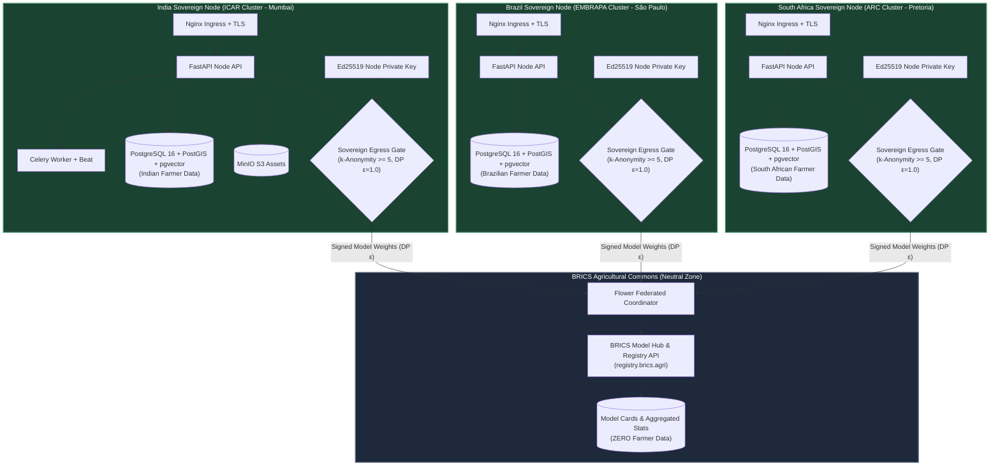

# Service Level Objectives (SLOs) & Sovereign Data Topology

This document formally states and justifies the Service Level Objectives (SLOs) for KrishiNet-BRICS and illustrates the sovereign multi-region cluster deployment topology.

---

## 1. Service Level Objectives (SLOs)

| Metric | Target | Error Budget (30-Day) | Justification & Rationale |
| :--- | :--- | :--- | :--- |
| **API Availability** | **99.5%** | 3.6 hours downtime | Farmers and extension officers operate in rural areas with intermittent connectivity. 99.5% ensures reliable service while allowing rolling updates and maintenance windows. |
| **Cached Read Latency (p95)** | **< 300 ms** | 5% of queries | Critical for mobile PWA usability over 2G/3G cellular links. Served via local Redis cache. |
| **Advisory Generation Latency (p95)** | **< 1,500 ms** | 5% of queries | Deterministic rules execute in < 250 ms. Hybrid Gemini synthesis is bounded to 1,500 ms before fallback triggers. |
| **Disease Diagnosis Latency (p95)** | **< 2,500 ms** | 5% of queries | Edge ONNX inference executes in < 300 ms; cloud ensemble verification completes within 2,500 ms. |
| **Advisory Freshness** | **< 24 Hours** | N/A | Telemetry snapshots (satellite NDVI, weather, soil) refresh daily to ensure farmers receive up-to-date agronomic actions. |
| **Messaging Delivery Latency (SMS/WhatsApp)**| **< 15 Seconds** | 1% delayed | Conversational FSM responses must arrive swiftly to maintain interactive chat pacing. |

---

## 2. Sovereign Multi-Cluster Topology Architecture

### Core Data Sovereignty Principle:
- **Each sovereign nation (India, Brazil, South Africa, etc.) runs its own dedicated Kubernetes cluster and PostgreSQL database located strictly within national borders.**
- **Farmer identities, raw soil metrics, farm polygons, and disease photos NEVER leave the national cluster.**
- **The BRICS Central Registry runs in a neutral cluster and stores ONLY anonymous aggregated model cards, differential-privacy model weights, and node metadata. It holds ZERO farmer personal data.**

